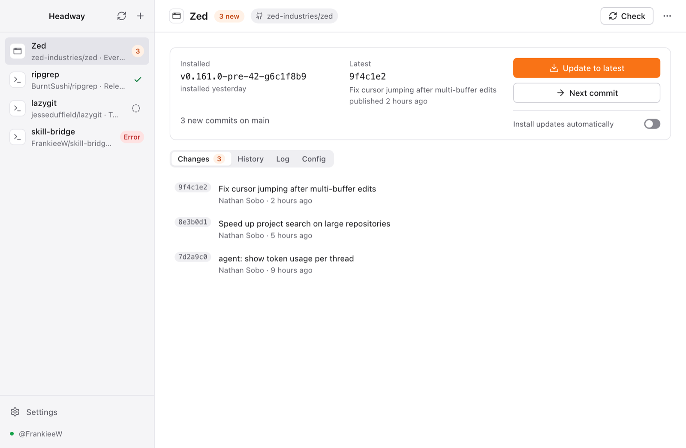

# Headway

Keep Mac apps and CLI tools current: **GitHub commits/releases, npm, Homebrew, or official updaters**.

Headway tracks GitHub repositories and installs new versions for you: a CLI tool into `~/.local/bin`,
an app bundle into `/Applications`. Each repository is followed one of two ways:

- **Every commit** on a branch: clone once, check out the new commit, run your build command, install
  the result. Step through one commit at a time (`--next`) or jump to the latest.
- **Releases** (or version tags): download the macOS asset for your CPU, verify GitHub's SHA-256
  digest, unpack the `.tar.gz`/`.zip`/`.dmg`, and install it. Release tags can also be built from source.

It comes as a menu-bar app and a CLI that share the same state. The CLI is built to be driven by AI
agents: structured XML/JSON output, stable error codes, self-description, and an agent skill.



## Install

```sh
brew install frankieew/tap/headway          # the `headway` CLI
brew install --cask frankieew/tap/headway   # the menu-bar app
```

Or download `Headway-<version>-<arch>.dmg` and `headway-<target>.tar.gz` from
[Releases](https://github.com/FrankieeW/headway/releases). The app is not notarized: when it is not
installed through the cask, open it the first time with right-click → Open.

## Quick start (CLI)

```sh
headway token set --from-gh                  # or: printf %s "$TOKEN" | headway token set --stdin
headway add BurntSushi/ripgrep               # inspects the repo: Cargo build, binary `rg`, follows master
headway add zed-industries/zed --track release   # download release assets (.dmg → /Applications)
headway check                                # what's new?
headway update ripgrep --dry-run             # see exactly what would happen
headway update ripgrep --next                # install only the next commit after the installed one
headway update --all                         # bring everything up to date
headway mark ripgrep latest                  # "I already have the latest", without building
headway update ripgrep --to 4a1b2c3          # roll back to any commit or tag
```

`headway --help` lists every command. `headway doctor` checks git, the token, `PATH` and build tools.

## Optional npm, Homebrew and official updater sources

GitHub tracking stays available. Select another source with a prefix or package URL:

```sh
headway add npm:@openai/codex --dist-tag latest
headway add https://www.npmjs.com/package/pnpm
headway add brew:ripgrep
headway add cask:zed                         # also: brew:zed --cask
headway add https://formulae.brew.sh/formula/jq
headway add script:claude --update-command 'claude update' --version-command 'claude --version'
headway check
headway update codex --dry-run
headway update codex --next
headway edit codex --dist-tag beta
```

npm installs globally through your `npm` and registry configuration. Homebrew delegates to your
`brew install`/`brew upgrade`, selecting `--formula` or `--cask`. Both detect installed versions
from your system. Script sources execute the updater command you supply; use the project's
trusted official instructions. Optional `--version-command` and `--latest-command` probes compare
installed and newest versions (the latter also accepts an HTTP(S) URL). Without enough information,
status is `unknown`; run that updater explicitly. `update --all` selects known available updates.

`--no-inspect` works for every source; scripts still need `--update-command`. `--package` edits an
npm/Homebrew package, and an empty version/latest command clears that script probe. GitHub and npm
support `--next` and `--to` rollback; Homebrew and scripts support only latest. `mark` and all
build/asset/track flags are GitHub-only. Inapplicable flags return an error. Existing GitHub config
continues to load; JSON/XML app records now expose a flattened `source` discriminator.

## Update Headway itself, one commit at a time

After these build recipes are on the tracked branch, Headway can build and update its own app:

```sh
headway --json add FrankieeW/headway --preset headway-app --branch main --dest ~/Applications/Headway.app
headway --json update headway --dry-run
headway --json update headway                 # first installation, latest supported commit
headway --json check headway
headway --json update headway --next          # subsequent updates, one commit at a time
```

The desktop preset runs `./scripts/build-headway.sh app`, builds only the `.app` (no DMG), and
bundles the matching CLI, ad-hoc signs the app, and verifies the staged signature before publishing
the artifact. The stable artifact is `.headway-out/Headway.app`; the script honors
`CARGO_TARGET_DIR`, uses the native Rust target by default, and retains Cargo/pnpm caches between
commits. Settings shows the running and installed builds separately. Request a restart there or
with `headway self restart`; the app waits for its active updates to finish and confirms the new
commit after relaunch. A failed restart is shown with a retry action.

For a standalone CLI instead, use a separate tracking id:

```sh
headway --json add FrankieeW/headway --id headway-cli --preset headway-cli --branch main
headway --json update headway-cli --dry-run
headway --json update headway-cli
headway --json update headway-cli --next
```

This recipe needs only git and Rust, runs `./scripts/build-headway.sh cli`, and stages
`.headway-out/headway`. Explicit `--kind` still overrides a preset's app/CLI default. Both recipes
use locked dependencies, build the exact checked-out commit, and leave installation to Headway's
existing staged replacement. They do not install, restart, or rewrite config by themselves.

For a local build, run `pnpm build:self` or `./scripts/build-headway.sh cli`. `--target` selects
`aarch64-apple-darwin` or `x86_64-apple-darwin` when that Rust target/toolchain is installed.
`headway --version` shows a short revision; `headway --json version` (or `version --ai`) returns
the full compile-time `commit`, `dirty`, and `target` beside the release version. The app's
existing version display uses the same compact identity. Unstamped plain Cargo builds report
null commit/target; a dirty build is explicitly labeled and is not a clean remote-commit baseline.

Only mark a baseline when you know the installed build's exact clean commit. The new recipes
require a commit containing `scripts/build-headway.sh`; older commits need their historical build
command. See [`examples/self-update.toml`](examples/self-update.toml) for equivalent config entries.
CI builds the self-hosted app and verifies its bundled CLI and signature on every change.

The app registers Headway as its first subscription when it finds its installed bundle. New self
subscriptions only notify; existing destinations and policies are preserved. A clean build stamp
can supply the commit baseline for that exact destination; release/tag baselines are preserved.
Use `headway --json self subscribe` to repeat registration. If the app moves, run
`headway --json cli fix --app /Applications/Headway/Headway.app`. This repairs Headway's own link;
it reports PATH shadowing and refuses to replace unrelated files or a Homebrew-owned link.

## Build detection, discovery and update policies

`inspect` reads README build instructions and source manifests without executing them. Its
`build_candidates` include the source file, line when available, command, workdir and artifact.
The add/edit dialog lets you apply a candidate and then edit every field. CLI overrides are
`--build`, `--workdir`, `--artifact` and `--dest`; review these before the first installation.

```sh
headway --json discover --source brew,npm      # read installed packages; does not import
headway --json import 'brew ripgrep' --dry-run  # use the exact key from discover
headway --json recipes
headway --json import recipe:headway-app --dry-run
headway edit ripgrep --auto-update true --update-mode next --max-update-steps 1 --pause-on-failure true
headway --json auto-update ripgrep             # one cycle using the saved policy
headway --json resume-auto-update ripgrep
```

Imports validate the entire batch, reject duplicate sources/IDs and start with automatic updates
off. Recipes remain editable. Automatic modes are `notify`, `next` and `latest`; `next` supports
1–20 steps per cycle, and failures can pause later cycles until resumed. Mode, source and step
budget changes take effect before another step. Manual `update --all` keeps its explicit behavior.

For GitHub apps, finding an installed file without a known baseline shows **installed, version
unconfirmed**. It does not invent a commit. Deleting a managed artifact clears stale installed
certainty so an update can reinstall it. npm and Homebrew continue to read their own inventories.

Each displayed commit can show its version, CI state and Release badge. Versions come from an
actual tag or a manifest at that exact SHA; a manifest version alone is not a release. CI distinguishes
success, failure, pending, not run and unavailable. `headway --json commit-info <id> <sha> --refresh`
returns the same evidence (`version_source`, `ci_state`, `is_release`, URLs and notes).

## Verification and cached recovery

```sh
headway edit ripgrep --verify-command '"$HEADWAY_INSTALLED_PATH" --version'
headway --json backups ripgrep
headway --json restore ripgrep <backup-id>
```

Managed GitHub artifact installs retain up to two prior payloads. Restoration checks the cache's
paths, digests, repository and tracking mode, then restores without a build. A failed post-install
verification restores the prior payload and recorded ref. `verify_command` runs with
`HEADWAY_INSTALLED_PATH`, `HEADWAY_REF`, `HEADWAY_SHA` and `HEADWAY_VERSION`; it is never run merely
to detect installation. Headway bundles also undergo native signature verification. External
package managers and builds that install themselves do not use this cache. Old cache manifests
without source identity are rejected explicitly. `remove --purge` also removes retained backups.

## Source storage and the full commit history

```sh
headway edit headway --keep-source true --source-root ~/Developer/HeadwaySources
headway --json source-storage headway
headway edit headway --keep-source false
headway --json commits headway --page 1 --per-page 20
headway --json commits headway --page 2 --per-page 20 --anchor <sha-from-page-1>
```

Source builds keep their checkout and build cache by default. A custom root contains a managed
child named after the app ID. With retention off, each build uses a temporary checkout under the
selected base and removes it after success, failure or cancellation. Turning retention off or
changing roots preserves older retained data. An empty `--source-root ''` restores the default.
Headway refuses to reuse or purge an unowned directory; purge leaves the custom root and siblings.

The app's **Commits** tab browses history one page at a time, including commits older than the
pending-update window. Pages reuse the first page's SHA anchor, so new commits arriving upstream
do not shift the history while you browse. Refresh begins a new snapshot.

## Choose a commit, recipe or independent version

```sh
headway --json commit-options headway <sha-or-tag>
headway --json install-commit headway <sha> --method source --dry-run
headway --json install-commit headway <tag> --method asset --dry-run
headway --json install-commit headway <sha> --method asset --release-tag <tag> --dry-run
headway --json install-commit headway <sha> --as headway-old --name 'Headway old' --dry-run
headway --json install-commit headway <sha> --as headway-old --name 'Headway old'
headway --json launch-variant headway-old
```

Any available commit can be installed again, upgraded to or downgraded to. A commit with a verified
published release can use a downloaded asset or a source build. Build fields and asset patterns
remain editable; the one-off choice preserves the main subscription's configured recipe and
destination. Download selection checks that the release tag identifies the selected SHA.
When an older release was resolved separately, `--release-tag` carries its tag alongside the SHA;
the app does this automatically and rechecks the association before installation.

`--as` creates a separate tracked installation with automatic updates off and an exact commit pin.
Apps go to `apps_dir/Headway Versions/<id>.app`; CLI binaries go to `bin_dir/<id>`. The preview
shows that independent destination. Existing destinations are refused, and a build that installs
itself without a managed artifact cannot be used for an independent version. A failed install
remains visible for inspection and retry. App launch uses the installed bundle's executable;
CLI versions run by their new name on PATH. **Application data remains shared** according to the
application's normal behavior; this release does not add profile/data isolation.

## Official repositories and forks

```sh
headway --json repo list headway
headway --json repo add headway my-account/headway --label 'My fork' --branch work
headway --json repo use headway my-account/headway
headway --json repo use headway FrankieeW/headway
headway --json repo remove headway my-account/headway
```

Each GitHub app can save several named repositories, with optional branch and clone URL per
origin. The active repository drives checks, commit browsing and installation. Switching is an
explicit action in the app; it retains installed bytes and clears the old repository's revision
baseline. Restore checks still enforce the backup's repository identity. Repository metadata and
commit badge caches are separated by origin.
An existing Headway fork at its managed location keeps its subscription and installer-recorded
baseline. Independent Headway instances keep the primary subscription and CLI link in place.

## The desktop app

- Select GitHub, npm, Homebrew (formula/cask), or a custom official updater in the add/edit dialog.
- Menu-bar icon with the number of apps that are behind, and a menu to check, update all, or jump to an app.
- Background checks every hour (configurable), notifications for available updates, and per-app
  automatic updates.
- Per app: installed vs latest, pending commits or versions, history, live update logs, and source
  configuration. GitHub and npm offer version selection/reinstall; GitHub also supports manual
  baselines. Scripts without enough probes show an unknown version status and can be run manually.
- Settings: GitHub token (stored in the macOS Keychain, or taken from `gh`), check interval, install
  locations, launch at login, theme, 中文/English, diagnostics, and an "Install `headway` command" button
  that links the CLI shipped inside the app into your `bin_dir`.
- Closing the window keeps Headway in the menu bar. Changes made with the CLI appear in the app within
  seconds.

## For AI agents

```sh
headway --ai list            # XML (or --json); HEADWAY_OUTPUT=xml makes it the default
headway --ai commands        # every command and flag, as data
```

- stdout carries exactly one document: `ok`, `command`, `data` or `error`, and `next` (suggested
  follow-up commands). Progress and build output go to stderr.
- Errors have a stable `code`, a `hint`, the last output lines of a failed build in `details`, and a
  stable exit code: `2` usage, `3` not found, `4` GitHub/network, `5` build/install failed, `6` busy,
  `7` cancelled, `1` other.
- `--dry-run` on `update`, `add`, `edit` and `remove` shows the plan without doing anything.
- The skill at [`skills/headway/SKILL.md`](skills/headway/SKILL.md) teaches an agent the workflow
  (install it next to your other skills).

## Configuration

`~/Library/Application Support/Headway/config.toml` (see `headway paths`), shared by the CLI and the app:

```toml
[settings]
check_interval_minutes = 60      # background checks in the app; 0 = off
notify = true
bin_dir = "~/.local/bin"         # default destination for CLI tools
apps_dir = "/Applications"       # default destination for .app bundles
gh_fallback = true               # use `gh auth token` when no token is set

[[app]]
id = "ripgrep"
name = "ripgrep"
repo = "BurntSushi/ripgrep"
kind = "cli"                     # or "app"
auto_update = false
track = { mode = "commit" }      # branch = "…" | { mode = "release", prerelease = false, tag_filter = "^v" } | { mode = "tag" }

[app.install]
method = "source"                # or "asset" (release mode): pattern = "*aarch64-apple-darwin.tar.gz", binary = "rg"
build = "cargo build --release --locked"
artifact = "target/release/rg"   # relative to the checkout (or `workdir`); `*` allowed; omit if the build installs itself
# dest = "~/bin/rg"              # default: bin_dir/apps_dir + the artifact's name
```

Build presets (`headway presets`): Cargo, `cargo install`, Go, SwiftPM, Xcode, Tauri, npm, Make.
Build commands run with `/bin/sh -c` in the checkout with `HEADWAY_REF`, `HEADWAY_SHA`,
`HEADWAY_VERSION`, `HEADWAY_BIN_DIR` and `HEADWAY_APPS_DIR` set.

| Variable | Effect |
|---|---|
| `HEADWAY_HOME` | keep config, cache and logs under one directory |
| `HEADWAY_GITHUB_TOKEN` | token for this process (overrides the keychain) |
| `HEADWAY_OUTPUT` | default output format: `human`, `json`, `xml` |
| `HEADWAY_API_URL` | GitHub API base (GitHub Enterprise, tests) |

Token lookup order: `HEADWAY_GITHUB_TOKEN` → Keychain → `GITHUB_TOKEN` → `GH_TOKEN` → `gh auth token`.
Public repositories work without a token (60 API requests/hour); for private ones a fine-grained
token with read-only *Contents* and *Metadata* access is enough.

## Security notes

- Source installs run the repository's build command on your machine. Track repositories you trust.
- The token lives in the login keychain and is read through `/usr/bin/security` (secret on stdin). Git
  gets it through `GIT_CONFIG_*` environment variables, never URLs or arguments. Build commands never
  get it, and `HEADWAY_GITHUB_TOKEN` is stripped from git and build environments; variables you
  export yourself (such as `GITHUB_TOKEN`) are inherited as in your shell.
- Builds run as you, so like any program you run they could read that keychain item through
  `/usr/bin/security`. Use a fine-grained token with read-only access.
- Downloads are not quarantined, so Gatekeeper does not vet installed apps. The SHA-256 digest proves
  the file is what the release published, not that the publisher is trustworthy.
- Release downloads are checked against the SHA-256 digest GitHub publishes for each asset.
- Installs are staged next to the destination and renamed into place, so a failed copy leaves the old
  version working. A plain directory is never replaced: `dest` names the file or the `.app` itself.

## Development

```sh
pnpm install
pnpm tauri dev                 # the app (Vite on :1420 + Rust)
cargo run -p headway-cli -- list
cargo test                     # engine + CLI, including end-to-end runs against real git
cargo test -p headway-desktop  # IPC contract tests (needs `pnpm build:renderer` once)
pnpm test && pnpm typecheck
```

UI preview without the backend: `pnpm dev:renderer`, then open
`http://localhost:1420/?mock` (`&theme=dark`, `&lang=en`).

Releases: `./scripts/bump-version.sh patch|minor|major|beta`, commit, tag `vX.Y.Z`, push; CI builds
the app (`.dmg`, `.app.zip`) and CLI tarballs for Apple Silicon and Intel and publishes a GitHub Release.

The tap's `Update Headway release` workflow polls stable releases every 15 minutes and can be run
manually. It checks both DMG digests and the source tag before opening a PR that changes only
`Formula/headway.rb` and `Casks/headway.rb`. The updater defaults to a dry run:
`node scripts/update-homebrew-tap.mjs --tap-root /path/to/homebrew-tap`. PR publication requires
`--apply --create-pr` and the official tap checkout. Release publication and tap PR merging remain
separate steps.

## 中文简介

Headway 是一个 macOS 菜单栏应用 + 命令行工具：跟踪 GitHub 仓库，**逐个 commit** 从源码构建，或**跟随版本号**
下载 Release 资源，自动安装到 `~/.local/bin` 或 `/Applications`。GitHub Token 保存在钥匙串里（也可以直接用
`gh` 的登录）。CLI 为 AI Agent 设计：`--ai` 输出 XML、`--json` 输出 JSON、稳定的错误码与退出码、
`headway commands` 自描述，并附带 `skills/headway/SKILL.md`。

支持 npm、Homebrew 和自定义官方升级脚本；可发现并导入已安装的软件。添加应用时可从 README 和源码清单
识别构建命令，再手动修改。自动更新支持仅通知、逐版本和最新版本；安装后可校验并保留两份历史产物供恢复。
每个 commit 可显示版本、CI 和 Release 标记。Headway 自身作为首个订阅，支持空闲后重启，以及移动 App 后修复 CLI 链接。

## License

MIT
